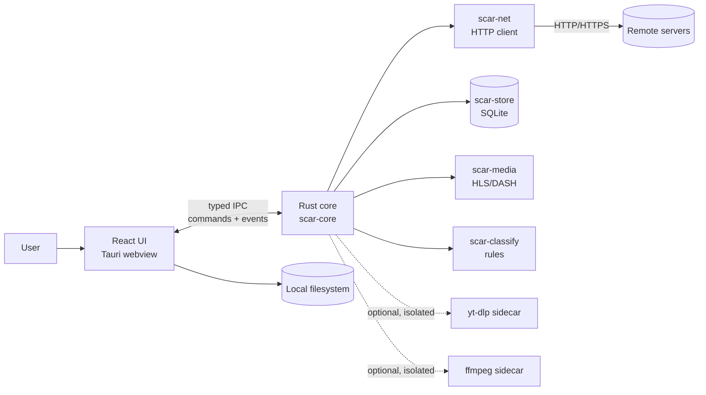
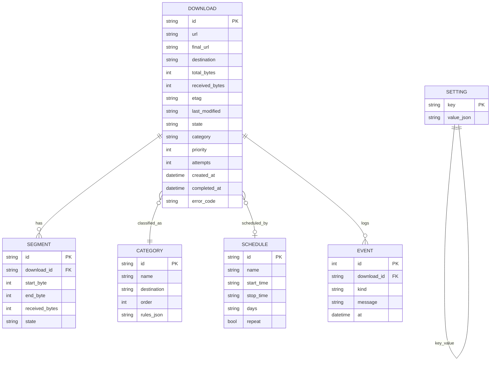
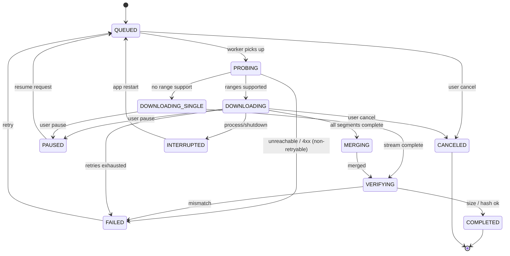
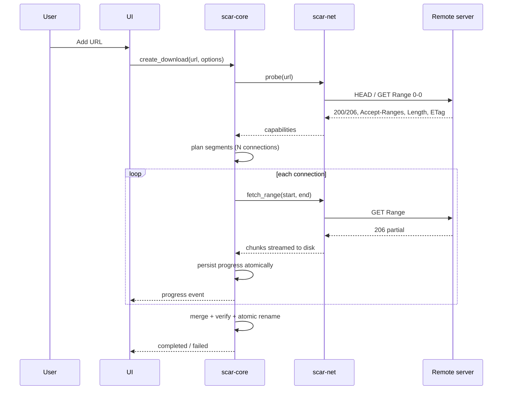

# Architecture — ScarDownloadManager

| Field | Value |
|---|---|
| Status | Draft — proposed design, awaiting approval |
| Scope | v1 desktop application (Windows, macOS, Linux) |
| Stack | Proposed: Tauri 2 + Rust core + React/TypeScript UI (see [ADR-0001](adr/0001-tech-stack.md)) |
| Implementation | None yet. This document describes intended structure, not existing code. |

---

## 1. Design principles

1. **The engine is a library, not a UI detail.** Download logic lives in Rust crates with no UI dependency, so it can be tested headlessly and reused by a future CLI.
2. **Crash-safe by construction.** Progress is persisted before it is reported as done; files appear at their destination only through an atomic rename after verification.
3. **Every network assumption is checked.** Range support, content length, validators, redirects, and content encoding are probed and verified — never assumed.
4. **The UI is replaceable.** The frontend talks to the core through a small, typed IPC surface; no business logic lives in React.
5. **Least privilege.** The webview gets only the capabilities it needs; the core never executes shell strings; user paths are validated.
6. **Localization is data, not code.** Every visible string comes from a locale file.

---

## 2. System context



---

## 3. Components

### 3.1 Desktop shell

**Tauri 2** hosts the webview and owns the native window, tray icon, notifications, single-instance handling, updater, and OS integration. It exposes a capability-scoped IPC bridge to the UI.

### 3.2 Frontend (`apps/desktop-ui`)

React 19 + TypeScript + Vite.

| Area | Responsibility |
|---|---|
| Downloads list | Live progress, speed, ETA, state, pause/resume/cancel/retry |
| Add-download dialog | URL validation, destination, category preview, advanced options |
| Queue / scheduler | Ordering, priorities, time windows, concurrency |
| Categories | Rule editor and destinations |
| Settings | Language, theme, connections, limits, proxy, updates |
| i18n provider | Locale loading, RTL direction, formatting |

State: a query/cache layer for IPC data plus local UI state. No download state is invented in the UI; it mirrors core events.

### 3.3 Rust core (workspace)

```text
crates/
├── scar-core/        # domain model, state machine, orchestration, queue, scheduler
├── scar-net/         # HTTP client, range probing, retries, proxies, speed accounting
├── scar-store/       # SQLite persistence, migrations, repositories
├── scar-media/       # HLS/DASH parsing, segment assembly, sidecar adapters
├── scar-classify/    # category rule engine
├── scar-ipc/         # command/event DTOs shared with the shell (serde)
└── scar-platform/    # paths, keychain, notifications, shutdown, locale detection
```

| Crate | Key responsibilities | Explicitly not responsible for |
|---|---|---|
| `scar-core` | Download lifecycle, segment planning, queue ordering, scheduler windows, pause/resume semantics | HTTP details, UI rendering, storage queries |
| `scar-net` | Connection pool, `Range` requests, redirect policy, retry/backoff, proxy, bandwidth throttling, hash/checksum streaming | Knowing what a "download" means |
| `scar-store` | Schema, migrations, atomic progress writes, history, settings, schedules | Business rules |
| `scar-media` | Manifest parsing, variant selection, segment ordering, mux decision | DRM handling (refused) |
| `scar-classify` | Extension and user rules, first-match resolution, destination templates | Moving files (core orchestrates) |
| `scar-platform` | OS paths, locale, keychain, notifications, shutdown | Cross-platform business logic |
| `scar-ipc` | Stable DTOs and versioned event names | Logic |

### 3.4 Sidecars (optional, isolated)

- **yt-dlp** (Unlicense): used only for allowlisted sites, launched with an argument array (never a shell string), sandboxed by capability and killed on cancel.
- **ffmpeg** (LGPL build preferred): muxing separate audio/video DASH tracks. Distribution decision gated by [ADR-0004](adr/0004-license.md).

Sidecars are feature-flagged, off by default, and never auto-downloaded silently.

---

## 4. Data model



Rules:

- `DOWNLOAD.state` follows the state machine in §5; illegal transitions are rejected in code and covered by tests.
- Segments are the unit of progress; `received_bytes` on the download is derived and reconciled on load.
- History rows are never edited after completion except for explicit user actions (move, delete record).

---

## 5. Download state machine



Invariants (to be asserted in tests):

- A download can never reach `COMPLETED` without passing `VERIFYING`.
- `PAUSED` always retains a resumable sidecar.
- `INTERRUPTED` is only produced by recovery on startup, never by user action.
- Cancel of a completed download is not a legal transition.

---

## 6. Segmented download flow



**Dynamic segmentation:** the planner keeps a cursor of unclaimed bytes. When a connection finishes its range, it claims the next unclaimed range from the cursor. This reuses warm connections and adapts to variable throughput, instead of pre-splitting the file into equal fixed chunks.

**Fallback:** if `Accept-Ranges` is absent or `206` is not honored, the download continues as `DOWNLOADING_SINGLE`.

---

## 7. Resume mechanism

Layout beside the destination:

```text
movie.mp4            # final file, appears only after verification
movie.mp4.scarpart   # binary partial data (preallocated, written in place)
movie.mp4.scarmeta   # atomic JSON: url, validators, segment table, version
```

Rules:

1. `scarmeta` is written via temp file + atomic rename on every meaningful progress boundary.
2. On resume, the core re-probes the URL and compares strong `ETag`, then weak `ETag`, then `Last-Modified` + size.
3. Mismatch → restart from zero, keep the old partial until the user confirms cleanup, and report the reason.
4. Segment table is the source of truth; bytes outside recorded ranges are treated as unknown and re-fetched.
5. Kill -9 during any write must leave a consistent `scarmeta` (tested).

---

## 8. IPC contract

- **Commands** (UI → core): `create_download`, `pause`, `resume`, `cancel`, `retry`, `set_priority`, `add_schedule`, `update_settings`, `list_downloads`, `choose_folder`, `set_locale`.
- **Events** (core → UI): `download_progress` (throttled), `download_state_changed`, `queue_changed`, `settings_changed`, `locale_changed`, `error`.
- DTOs live in `scar-ipc`, derive `serde`, and are versioned; breaking changes require an ADR.
- Progress events are coalesced (e.g., ≤ 4 Hz per download) to keep the webview responsive.
- The UI never receives filesystem paths it did not request; paths are validated and canonicalized.

---

## 9. Security boundaries

| Boundary | Control |
|---|---|
| Webview ↔ core | Capability allowlist; no arbitrary shell; typed commands only; CSP `default-src 'self'` |
| URL input | `http`/`https` only; reject `file:`, `javascript:`, `data:`; length and control-character limits |
| Filesystem | Destination validated against allowed roots; path traversal rejected; symlink escape checked |
| Sidecars | Fixed executable paths; argument arrays; no shell; output parsed defensively; timeouts; kill on cancel |
| Secrets | OS keychain for proxy credentials; never written to logs or SQLite |
| Updates | Signed artifacts; public key pinned; refusal path tested |
| Dependencies | Lockfiles committed; CI vulnerability and license scan |
| Logs | No URLs with tokens by default; redact query secrets |

Explicit threat-model notes (STRIDE-lite) live alongside this section and will be expanded in Phase 1 with a review checklist.

---

## 10. Storage

- SQLite in WAL mode at the platform app-data directory; single writer through `scar-store`.
- Versioned migrations, applied on startup, with a backup before destructive ones.
- Settings live in the same database (single source of truth), with an export/import path.
- No user file is stored in the database; only paths and metadata.

---

## 11. Internationalization pipeline

1. Locale files: `locales/<lang>/<namespace>.json` in the UI, loaded at runtime.
2. ICU message format for plurals, gender, and selection.
3. Locale resolution: explicit user setting → installer-seeded choice → OS locale → English.
4. `dir` attribute switched per locale; RTL layout uses logical CSS properties and mirrored directional icons.
5. CI checks: missing keys, unused keys, and hardcoded strings (lint rule).
6. Adding a language = adding files + registering the locale; no code change.

---

## 12. Failure modes

| Failure | Detection | Behavior |
|---|---|---|
| Server drops connection | IO error / timeout | Retry with backoff, resume at last confirmed byte |
| Range ignored by server | Non-206 response | Switch to single stream, inform user |
| Remote file changed | Validator mismatch | Restart download, keep evidence, explain |
| Disk full | Write error | Pause, notify, keep metadata; retry when space returns |
| Destination locked (Windows) | Rename failure | Retry with backoff, surface antivirus hint |
| App crash / power loss | Sidecar inconsistency | Recovery scan on startup; nothing marked complete falsely |
| Clock jump / DST | Scheduler tick | Recompute next window; tests with fake clock |
| Corrupt manifest | Parser error | Fail the item, keep queue running, log detail |

---

## 13. Build, packaging, CI

- Tauri bundlers: Windows NSIS (and MSI later), macOS `.dmg` (universal or per-arch), Linux AppImage + `.deb`.
- GitHub Actions matrix: `windows-latest`, `macos-latest`, `ubuntu-22.04`.
- Jobs: docs checks, Rust fmt/clippy/test, frontend lint/typecheck/test, Tauri build, release (tags only).
- Release artifacts are signed; secrets live in GitHub Actions secrets only.
- Unsigned development builds are watermarked and blocked from the update channel.

---

## 14. Testing strategy

| Layer | Tool (proposed) | What it proves |
|---|---|---|
| Rust unit | `cargo test` | Segment planner, state machine, validators, rules, locale resolution |
| Rust integration | local HTTP test server (range/no-range/slow/flaky/redirect) | Resume, fallback, retries, integrity |
| Frontend unit | Vitest + Testing Library | State rendering, i18n formatting, RTL snapshots |
| E2E | WebDriver/Playwright against a built app | Add → download → complete flow on each OS |
| Property/fuzz | `proptest`/`cargo-fuzz` on parsers | Malformed manifests and headers never panic |
| Security | dependency + license scan; path traversal tests | Boundaries hold |

Test fixtures are local and deterministic; CI never depends on the public internet for core tests.

---

## 15. Observability and privacy

- Local structured logs with rotation; no upload.
- Crash reports are opt-in, scrubbed, and documented.
- No analytics SDK, no third-party tracking, no telemetry endpoint in the codebase by default.
